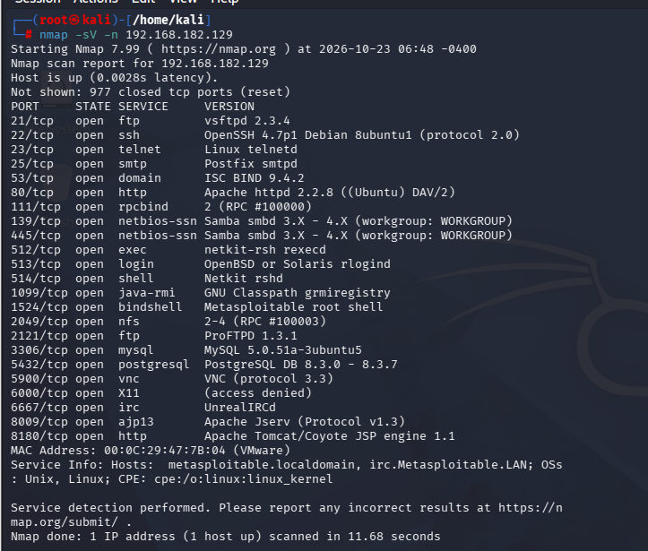

# Nmap Service Vulnerability Scan

## Objective
Perform a service version scan on the Metasploitable 2 target to identify open ports, running services and version information, then assess the highest-risk findings.

## Environment & Tools
- Lab: Isolated host-only virtual lab (Kali Linux + Metasploitable 2)
- Tool: Nmap 7.99
- Command used: `nmap -sV -n 192.168.182.129`

## Step-by-step Method
1. Confirmed network connectivity between Kali and the target via ping test.
2. Ran a basic port scan to identify all open TCP ports on the target.
3. Ran a service version scan (`-sV`) to detect exact software versions for each open service.
4. Cross-referenced version numbers with known vulnerabilities to identify high-risk services.
5. Recorded all scan output and analysed the four most dangerous ports.

## Results
The scan revealed 22 open TCP ports running outdated services with multiple critical vulnerabilities.

### Evidence
Full Nmap service version scan output:

The four highest-risk findings are:
- **Port 21 (vsftpd 2.3.4)**: Contains a well

## Reflection & Improvements
In a follow-up test I would add vulnerability script scanning with `nmap --script=vuln` to automatically detect known CVE issues. I would also export the results into a formal report format and add risk ratings for each finding.
