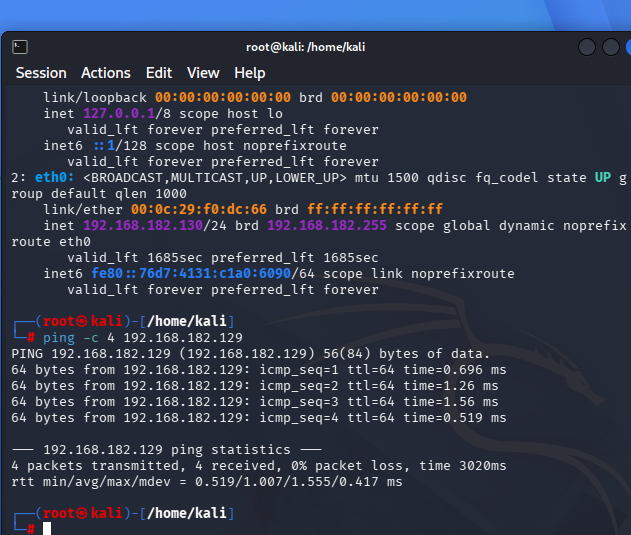

# Virtual Lab Setup

## Objective
Build a fully isolated virtual penetration testing lab to safely practice security tools, with no connection to the home network or public internet.

## Environment & Tools
- Hypervisor: VMware Workstation
- Attacker machine: Kali Linux 2026.2
- Target machine: Metasploitable 2 (intentionally vulnerable Linux system)
- Network mode: Host-only (VMnet1)

## Step-by-step Method
1. Installed VMware Workstation as the hypervisor, and deployed both Kali Linux and Metasploitable 2 virtual machines.
2. Configured the network adapter of both VMs to **host-only mode** to enforce network isolation.
3. Verified the IP addresses of both machines via `ip addr` command.
    - Kali (attacker): 192.168.182.130
    - Metasploitable 2 (target): 192.168.182.129
4. Confirmed internal connectivity by running `ping -c 4 192.168.182.129` from Kali, with 0% packet loss.
5. Verified network isolation by testing connection to public external addresses, confirming no internet access from the lab.

## Results
The lab was successfully built with full isolation. Both machines can communicate with each other over the host-only subnet, and cannot reach external networks.

### Evidence
**Kali Linux IP configuration:**

**Metasploitable 2 IP configuration:**

**Connectivity ping test (Kali to target):**

**Network topology diagram:**

Full network setting screenshots are stored in this `evidence/` folder.

## Reflection & Improvements
If I were to rebuild this lab, I would add a second target machine and a virtual firewall to simulate a more realistic segmented network. I would also add GNS3 to practice routing-level security testing.
